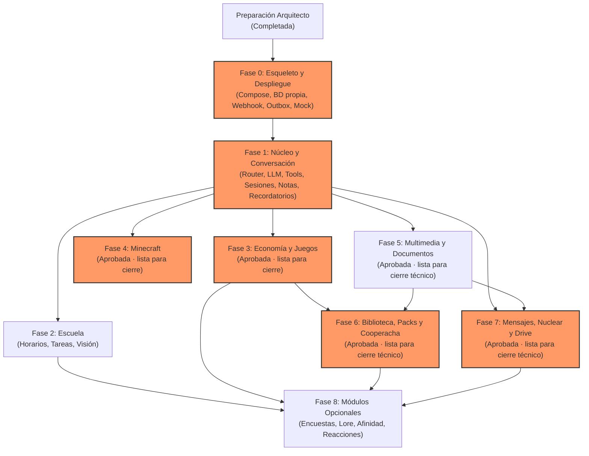

# Botsky — Roadmap de Desarrollo y Asignación de Tareas

**Archivo:** `docs/ROADMAP.md`  
**Versión:** 2.3  
**Rol responsable:** Arquitecto / Revisor  
**Fuente de verdad:** `docs/PLAN_MAESTRO.md` §3 y `AGENTS.md`

Este documento define las dependencias entre fases, la estrategia de paralelización segura, las tareas críticas que exigen revisión del arquitecto y los perfiles recomendados para los agentes constructores.

---

## 1. Grafo de Dependencias entre Fases

---

## 2. Matriz de Fases y Asignación de Roles

| Fase | Título | Dependencias | ¿Paralelizable? | Cambio Crítico | Perfil / Rol de Agente Recomendado |
|---|---|---|---|:---:|---|
| **0** | **Esqueleto y Despliegue** | Preparación arquitecto | **NO** | **SÍ** | Constructor Backend / Infraestructura Docker & SQL |
| **1** | **Núcleo y Conversación** | Fase 0 en verde | **NO** | **SÍ** | Constructor Arquitectura de Software & LLM |
| **2** | **Escuela** | Fase 1 | **SÍ** (con Fase 3, 4 o 5) | No | Constructor Lógica de Negocio & Visión |
| **3** | **Economía y Juegos** | Fase 1 | **SÍ** (con Fase 2 o 4) | **SÍ** | Constructor Transaccional & Algoritmos Puros |
| **4** | **Minecraft** | Fase 1 | **SÍ** (con Fase 2 o 3) | **SÍ** | Constructor Infraestructura & Seguridad Shell/SSH |
| **5** | **Multimedia y Documentos** | Fase 1 | **SÍ** (con Fase 2, 3 o 4) | Parcial | Constructor Procesamiento de Medios & Worker |
| **6** | **Biblioteca, Packs y Cooperacha** | Fases 3 y 5 | **SÍ** (con Fase 4 o 7) | **SÍ** | Constructor Fullstack Transaccional |
| **7** | **Mensajes, Difusión y Nuclear** | Fases 1 y 5 | **SÍ** (con Fase 4 o 6) | **SÍ** | Constructor Resiliencia de Red & Operaciones Masivas |
| **8** | **Módulos Opcionales** | Fases previas según módulo | **SÍ** (módulo a módulo) | Parcial | Constructor Extensiones & Comunidad |

---

## 3. Condiciones Estrictas para Paralelización

De acuerdo con `AGENTS.md` §3, la paralelización entre agentes solo está permitida bajo las siguientes reglas:

1. **Fase 0 y Fase 1 son estrictamente secuenciales:**
   - La Fase 0 sienta la base del sistema operativo, webhook, base de datos y scripts de despliegue.
   - La Fase 1 implementa el contrato de `Tool`, el router principal y el sistema de sesiones que todos los demás módulos consumen.
   - **Bajo ninguna circunstancia se deben abrir constructores en paralelo durante las Fases 0 y 1.**
2. **Aislamiento por Rama o Worktree:**
   - Cada constructor debe trabajar en su propia rama (`phase-N-nombre`) o en un directorio `git worktree` aislado.
   - **Nunca** dos agentes deben modificar la rama `main` o un mismo archivo simultáneamente.
3. **Frentes de Trabajo Paralelos Permitidos tras la Fase 1:**
   - **Paralelo A:** Fase 2 (Escuela) y Fase 3 (Economía y Juegos). No comparten esquemas SQL ni herramientas; Escuela reside en `src/modules/school/` y Economía en `src/modules/xp/` y `src/modules/games/`.
   - **Paralelo B:** Fase 4 (Minecraft) y Fase 5 (Multimedia). Minecraft es puramente infraestructura de red externa (`src/modules/minecraft/`), mientras que Multimedia se concentra en el proceso `worker.ts` y conversiones locales en `src/modules/media/`.
4. **Reconciliación y Merge:**
   - Cada rama que termine debe ejecutar `typecheck`, `lint`, suite de tests y verificar el healthcheck antes de solicitar merge.
   - Si se presenta un conflicto de merge o colisión de migraciones SQL, la tarea vuelve al arquitecto para ordenamiento antes de tocar `main`.

---

## 4. Cambios Críticos que Requieren Revisión Obligatoria del Arquitecto

Antes de fusionar una rama a `main`, el agente debe solicitar la revisión del arquitecto (utilizando el **Prompt de Revisor** de `docs/PROMPTS.md`) en los siguientes casos:

1. **Infraestructura y Despliegue:**
   - Modificaciones a `scripts/deploy.sh`, scripts de respaldo o rollback.
   - Cambios en el `docker-compose.yml` que involucren redes de Evolution o variables sensibles.
2. **Identidad, Permisos y Resolución de Identidades:**
   - Cambios en `core/permissions.ts`, resolución de JIDs canónicos o asociación de identidades `@lid`.
3. **Flujo de Mensajería y Fiabilidad:**
   - Cambios al contrato de `Tool`, router principal, normalización o sistema de sesiones.
   - Deduplicación (`seen_events`), outbox y reconciliación de mensajes inciertos.
4. **Economía y Dinero Comunitario:**
   - Reglas de balance de XP, transacciones del `xp_ledger`, apuestas de blackjack y ruleta.
   - Mecanismo de expulsión temporal (`roulette_kick`) y enlace privado de reinvitación (`roulette_reinvite`).
   - Retenciones y devoluciones de la cooperacha.
5. **Infraestructura Externa y Shell:**
   - Acceso SSH a Minecraft en `redspi`, script `mc-ctl.sh` y comando forzado en `authorized_keys`.
   - Modificaciones a la ejecución segura de comandos externos (`execFile` con argumentos separados).
6. **Operaciones Masivas y Alto Riesgo:**
   - Campañas de difusión y operación `nuclear` (ritmo controlado, vista previa obligatoria y confirmaciones ligadas).
   - Sincronización bidireccional entre Google Drive y la biblioteca local del VPS.

---

## 5. Estrategia de Asignación de Agentes por Capacidad

En lugar de atar rígidamente herramientas específicas (como Antigravity o Codex) a fases inamovibles, la asignación de agentes debe basarse en el tipo de tarea y el contexto del entorno:

### 5.1 Perfil: Arquitecto / Revisor
- **Enfoque:** Visión global, coherencia arquitectónica, resolución de contradicciones, auditoría de seguridad y revisión de cambios críticos.
- **Responsabilidad:** Mantenimiento de `ENTORNO.md`, `DECISIONES.md`, `ROADMAP.md` e `INCIDENTES.md`. Aprobación o rechazo de PRs críticos.
- **Modo de operación:** Generalmente en solo lectura para inspección, o edición de documentación de control. No implementa código de negocio.

### 5.2 Perfil: Constructor de Backend e Infraestructura (Fase 0, 4)
- **Enfoque:** Docker Compose, configuración de redes internas, cliente PostgreSQL, migraciones SQL puras, scripts de automatización Bash (`deploy.sh`, `backup.sh`, `panic.sh`), integración SSH y Tailscale.
- **Habilidades clave:** Rigor en validación de variables de entorno, manejo de errores de sistema y scripts idempotentes.

### 5.3 Perfil: Constructor de Arquitectura y Lógica Central (Fase 1)
- **Enfoque:** Modelado de tipos TypeScript estricto, Zod schemas, diseño del pipeline de mensajes, router determinista vs. LLM, integración con Gemini API, control de cuotas y personalidad (`persona.md`).
- **Habilidades clave:** Diseño limpio de interfaces, decoupling y control de contexto de LLM.

### 5.4 Perfil: Constructor de Negocio y Transaccional (Fase 2, 3, 6)
- **Enfoque:** Lógica determinista, transacciones de base de datos (`BEGIN...COMMIT`), máquinas de estados para juegos por turnos, Fisher-Yates, cálculos de rachas y retenciones.
- **Habilidades clave:** Diseño de tests exhaustivos para condiciones de carrera y límites numéricos.

### 5.5 Perfil: Constructor de Procesamiento y Resiliencia (Fase 5, 7, 8)
- **Enfoque:** Colas de procesamiento asíncrono con `SKIP LOCKED`, integración de herramientas CLI (`ffmpeg`, `pdftoppm`, `tesseract`), outbox con backoff exponencial, ritmo de mensajería masiva con jitter.
- **Habilidades clave:** Gestión de memoria de procesos, timeouts seguros y manejo de fallos transitorios.

---

## 6. Estado y siguiente paso inmediato

Las **Fases 0–6 están cerradas y fusionadas a `main`**, por instrucción directa del
dueño; base `ffc30aa3e210363a8d565defd28901d0639a80f8`. Está autorizada únicamente
la **Fase 7 — Mensajes, difusión, Nuclear y Drive** en
`phase-7-mensajeria-difusion-nuclear-drive`, un constructor, sin delegación.

Alcance y plan previo en FASE-7.md y DEC-051–054. Se conservan las barreras de Lab,
las 548 regresiones y todos los controles de fases anteriores. No hay programador
genérico nuevo ni Fase 8. Nuclear real requiere aviso previo al dueño con el texto
y cantidad exactos; esta ejecución usa pruebas aisladas sin envíos físicos.

Fase 7 implementada y desplegada desde `88a8281`, con respaldo verificado,
639/639 tests, multimedia 82/82, procesadores reales 17/17, wrapper Minecraft 14/14,
typecheck/lint/build correctos y health HTTP 200. Evidencia en FASE-7-PRUEBAS.md.
Estado: **aprobada arquitectónicamente y lista para cierre técnico** (DEC-054).
Siguiente paso autorizado: registro documental, repetición de verificaciones y
commit/push en la rama de Fase 7; después, **constructor detenido**.
**Sin merge a main, Fase 8 ni activaciones fuera de Botsky Lab**.

## 7. Autorización y aprobación de Fase 5 — 16-10-2026

La instrucción directa del dueño confirma Fases 0–4 cerradas y fusionadas, base
`afe4b84a853308c02c7e52e650d15b00310083cc`, y autoriza únicamente Fase 5 en
`phase-5-multimedia-documentos`. Esa autorización superó el bloqueo histórico de
Fase 4 (DEC-042) únicamente dentro de ese alcance.
Un constructor, sin paralelización, merge ni inicio de Fase 6/7. Módulos nuevos
conservan barrera de Botsky Lab; ningún grupo real se activa.

Implementación y evidencia en FASE-5.md y FASE-5-PRUEBAS.md. DEC-043–045 quedan
aprobadas sin correcciones; DEC-046 registra formalmente la aprobación comunicada
por el dueño. La siguiente acción autorizada es cerrar esta verificación documental
y detenerse, sin avanzar a otra fase.

Fase 5 implementada y desplegada desde `7675380`: 445/445 Vitest, wrapper 14/14,
82/82 comprobaciones focalizadas posteriores, 17/17 procesadores reales y health
HTTP 200. QR/Piper y audio Gemini comprobados en integración aislada, sin envíos
reales. Pruebas físicas siguen pendientes, recomendables y no bloqueantes para el
cierre técnico. Estado: **aprobada y lista para cierre técnico**; sin merge,
Fase 6/7 ni activaciones fuera de Lab.

## 8. Autorización y aprobación de Fase 6 — 16-10-2026

La instrucción directa del dueño confirma Fases **0–5 cerradas y fusionadas** en
`main=03cffae779407102a030f95ecf759bdfaeda0438` y autoriza únicamente Fase 6 en
`phase-6-biblioteca-packs-cooperacha`. Prevalece sobre los bloqueos históricos de
los apartados 6/7 y DEC-046 dentro de ese alcance. Un constructor, sin delegación
ni paralelización. **Sin merge a main, Fase 7 ni activación fuera de Lab**.

Alcance: catálogo híbrido persistente local/Drive readonly con discovery dinámico,
reservas XP/packs privados, cooperacha con devolución/recompensa grupal, lluvia
expresa y pack del airdrop. DEC-047–049 y documentación de Fase 6 quedan aprobadas
sin correcciones; DEC-050 registra la aprobación arquitectónica. Contenido real,
OAuth/rclone y pruebas físicas no bloquean el cierre técnico. OAuth/Drive es
opcional: la biblioteca puede operar solo con contenido local autorizado.
La carga de contenido real es necesaria antes de probar/activar fuera de Lab;
las pruebas físicas son necesarias solo antes de activar fuera de Lab. No se
declara sincronización Drive ni entrega WhatsApp real sin evidencia.

Fase 6 **implementada y desplegada desde 46aeb3a** por el script oficial, respaldo
verificado y health HTTP 200 con base/Evolution conectados. 548/548 pruebas,
multimedia 82/82, wrapper Minecraft 14/14, typecheck/lint/build correctos. Evidencia
de procesadores/rclone y pendientes en FASE-6-PRUEBAS.md. Sin contenido real de
biblioteca ni OAuth; Drive deshabilitado, lluvia apagada, cero grupos fuera de Lab.
**Estado: aprobada y lista para cierre técnico.** Siguiente paso autorizado:
registrar la aprobación, repetir verificaciones y hacer commit/push documental;
después detenerse. Sin merge ni Fase 7, sin eliminar tests ni cobertura.

## 9. Autorización y aprobación vigente de Fase 7 — 17-10-2026

El dueño confirma el cierre/fusión de Fases 0–6 y autoriza implementar solo Fase 7.
Esta instrucción supera los bloqueos históricos de DEC-050 y apartados 7/8 dentro
de ese alcance. Difusión, permisos, outbox y Drive son cambios críticos; la revisión
arquitectónica fue aprobada sin correcciones de código, migraciones, scripts ni
configuración, según la instrucción del dueño registrada en DEC-054.

**Fase 7 aprobada y lista para cierre técnico.** Nuclear sin menciones cumple §9.10:
las menciones dependen de soporte fiable de Evolution. Se conserva la ráfaga
obligatoria de 5–10 mensajes y todos los límites implementados. Las pruebas físicas
de difusión/Nuclear no bloquean el cierre técnico y son requeridas solo antes de
activar fuera de Botsky Lab. OAuth y política de retención remota se requieren
únicamente antes de activar Drive, que permanece deshabilitado. No se eliminan
tests ni cobertura.

Solo se autoriza documentación de control, verificaciones y commit/push a la rama
de Fase 7; después detenerse. **Sin merge a main, inicio de Fase 8 ni activaciones
fuera de Lab**. No se requieren nuevas acciones manuales del dueño para este cierre
documental.
