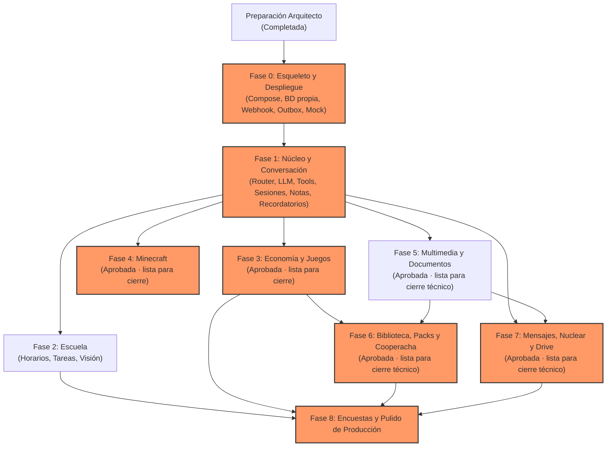

# Botsky — Roadmap de Desarrollo y Asignación de Tareas

**Archivo:** `docs/ROADMAP.md`  
**Versión:** 2.3  
**Rol responsable:** Arquitecto / Revisor  
**Fuente de verdad:** `docs/PLAN_MAESTRO.md` §3 y `AGENTS.md`

Este documento define las dependencias entre fases, la estrategia de paralelización segura, las tareas críticas que exigen revisión del arquitecto y los perfiles recomendados para los agentes constructores.

---

## 1. Grafo de Dependencias entre Fases

---

## 2. Matriz de Fases y Asignación de Roles

| Fase | Título | Dependencias | ¿Paralelizable? | Cambio Crítico | Perfil / Rol de Agente Recomendado |
|---|---|---|---|:---:|---|
| **0** | **Esqueleto y Despliegue** | Preparación arquitecto | **NO** | **SÍ** | Constructor Backend / Infraestructura Docker & SQL |
| **1** | **Núcleo y Conversación** | Fase 0 en verde | **NO** | **SÍ** | Constructor Arquitectura de Software & LLM |
| **2** | **Escuela** | Fase 1 | **SÍ** (con Fase 3, 4 o 5) | No | Constructor Lógica de Negocio & Visión |
| **3** | **Economía y Juegos** | Fase 1 | **SÍ** (con Fase 2 o 4) | **SÍ** | Constructor Transaccional & Algoritmos Puros |
| **4** | **Minecraft** | Fase 1 | **SÍ** (con Fase 2 o 3) | **SÍ** | Constructor Infraestructura & Seguridad Shell/SSH |
| **5** | **Multimedia y Documentos** | Fase 1 | **SÍ** (con Fase 2, 3 o 4) | Parcial | Constructor Procesamiento de Medios & Worker |
| **6** | **Biblioteca, Packs y Cooperacha** | Fases 3 y 5 | **SÍ** (con Fase 4 o 7) | **SÍ** | Constructor Fullstack Transaccional |
| **7** | **Mensajes, Difusión y Nuclear** | Fases 1 y 5 | **SÍ** (con Fase 4 o 6) | **SÍ** | Constructor Resiliencia de Red & Operaciones Masivas |
| **8** | **Encuestas mínimas y pulido de producción** | Fases 0–7 cerradas | **NO** | **SÍ** | Constructor principal; auditoría final pendiente |

---

## 3. Condiciones Estrictas para Paralelización

De acuerdo con `AGENTS.md` §3, la paralelización entre agentes solo está permitida bajo las siguientes reglas:

1. **Fase 0 y Fase 1 son estrictamente secuenciales:**
   - La Fase 0 sienta la base del sistema operativo, webhook, base de datos y scripts de despliegue.
   - La Fase 1 implementa el contrato de `Tool`, el router principal y el sistema de sesiones que todos los demás módulos consumen.
   - **Bajo ninguna circunstancia se deben abrir constructores en paralelo durante las Fases 0 y 1.**
2. **Aislamiento por Rama o Worktree:**
   - Cada constructor debe trabajar en su propia rama (`phase-N-nombre`) o en un directorio `git worktree` aislado.
   - **Nunca** dos agentes deben modificar la rama `main` o un mismo archivo simultáneamente.
3. **Frentes de Trabajo Paralelos Permitidos tras la Fase 1:**
   - **Paralelo A:** Fase 2 (Escuela) y Fase 3 (Economía y Juegos). No comparten esquemas SQL ni herramientas; Escuela reside en `src/modules/school/` y Economía en `src/modules/xp/` y `src/modules/games/`.
   - **Paralelo B:** Fase 4 (Minecraft) y Fase 5 (Multimedia). Minecraft es puramente infraestructura de red externa (`src/modules/minecraft/`), mientras que Multimedia se concentra en el proceso `worker.ts` y conversiones locales en `src/modules/media/`.
4. **Reconciliación y Merge:**
   - Cada rama que termine debe ejecutar `typecheck`, `lint`, suite de tests y verificar el healthcheck antes de solicitar merge.
   - Si se presenta un conflicto de merge o colisión de migraciones SQL, la tarea vuelve al arquitecto para ordenamiento antes de tocar `main`.

---

## 4. Cambios Críticos que Requieren Revisión Obligatoria del Arquitecto

Antes de fusionar una rama a `main`, el agente debe solicitar la revisión del arquitecto (utilizando el **Prompt de Revisor** de `docs/PROMPTS.md`) en los siguientes casos:

1. **Infraestructura y Despliegue:**
   - Modificaciones a `scripts/deploy.sh`, scripts de respaldo o rollback.
   - Cambios en el `docker-compose.yml` que involucren redes de Evolution o variables sensibles.
2. **Identidad, Permisos y Resolución de Identidades:**
   - Cambios en `core/permissions.ts`, resolución de JIDs canónicos o asociación de identidades `@lid`.
3. **Flujo de Mensajería y Fiabilidad:**
   - Cambios al contrato de `Tool`, router principal, normalización o sistema de sesiones.
   - Deduplicación (`seen_events`), outbox y reconciliación de mensajes inciertos.
4. **Economía y Dinero Comunitario:**
   - Reglas de balance de XP, transacciones del `xp_ledger`, apuestas de blackjack y ruleta.
   - Mecanismo de expulsión temporal (`roulette_kick`) y enlace privado de reinvitación (`roulette_reinvite`).
   - Retenciones y devoluciones de la cooperacha.
5. **Infraestructura Externa y Shell:**
   - Acceso SSH a Minecraft en `redspi`, script `mc-ctl.sh` y comando forzado en `authorized_keys`.
   - Modificaciones a la ejecución segura de comandos externos (`execFile` con argumentos separados).
6. **Operaciones Masivas y Alto Riesgo:**
   - Campañas de difusión y operación `nuclear` (ritmo controlado, vista previa obligatoria y confirmaciones ligadas).
   - Sincronización bidireccional entre Google Drive y la biblioteca local del VPS.

---

## 5. Estrategia de Asignación de Agentes por Capacidad

En lugar de atar rígidamente herramientas específicas (como Antigravity o Codex) a fases inamovibles, la asignación de agentes debe basarse en el tipo de tarea y el contexto del entorno:

### 5.1 Perfil: Arquitecto / Revisor
- **Enfoque:** Visión global, coherencia arquitectónica, resolución de contradicciones, auditoría de seguridad y revisión de cambios críticos.
- **Responsabilidad:** Mantenimiento de `ENTORNO.md`, `DECISIONES.md`, `ROADMAP.md` e `INCIDENTES.md`. Aprobación o rechazo de PRs críticos.
- **Modo de operación:** Generalmente en solo lectura para inspección, o edición de documentación de control. No implementa código de negocio.

### 5.2 Perfil: Constructor de Backend e Infraestructura (Fase 0, 4)
- **Enfoque:** Docker Compose, configuración de redes internas, cliente PostgreSQL, migraciones SQL puras, scripts de automatización Bash (`deploy.sh`, `backup.sh`, `panic.sh`), integración SSH y Tailscale.
- **Habilidades clave:** Rigor en validación de variables de entorno, manejo de errores de sistema y scripts idempotentes.

### 5.3 Perfil: Constructor de Arquitectura y Lógica Central (Fase 1)
- **Enfoque:** Modelado de tipos TypeScript estricto, Zod schemas, diseño del pipeline de mensajes, router determinista vs. LLM, integración con Gemini API, control de cuotas y personalidad (`persona.md`).
- **Habilidades clave:** Diseño limpio de interfaces, decoupling y control de contexto de LLM.

### 5.4 Perfil: Constructor de Negocio y Transaccional (Fase 2, 3, 6)
- **Enfoque:** Lógica determinista, transacciones de base de datos (`BEGIN...COMMIT`), máquinas de estados para juegos por turnos, Fisher-Yates, cálculos de rachas y retenciones.
- **Habilidades clave:** Diseño de tests exhaustivos para condiciones de carrera y límites numéricos.

### 5.5 Perfil: Constructor de Procesamiento y Resiliencia (Fase 5, 7, 8)
- **Enfoque:** Colas de procesamiento asíncrono con `SKIP LOCKED`, integración de herramientas CLI (`ffmpeg`, `pdftoppm`, `tesseract`), outbox con backoff exponencial, ritmo de mensajería masiva con jitter.
- **Habilidades clave:** Gestión de memoria de procesos, timeouts seguros y manejo de fallos transitorios.

---

## 6. Estado y siguiente paso inmediato

Fases **0–7 cerradas, aprobadas y fusionadas a main** por instrucción directa del
dueño; base `1bbaa5eed07ec4db20713d6f62d1fa11a44fa758`. Está autorizada únicamente
Fase 8 — Encuestas mínimas y pulido de producción, en
`phase-8-encuestas-pulido-produccion`, un constructor sin delegación ni paralelización.

DEC-055–057 y FASE-8.md fijan alcance, plan crítico y límites. Sin merge a main,
sin activaciones de grupos reales por el constructor y sin declaración de Botsky
v1 terminado. Implementada y desplegada desde `d24eded`: 702/702 tests, multimedia 82/82,
procesadores 17/17, wrapper 14/14, backup/restore aislado y health verdes.
Solo Lab habilitado. Pendiente auditoría FINAL y saneamiento de doce blobs
históricos con JIDs (DEC-057); árbol actual limpio. Constructor detenido.
Las secciones 7–9 conservan el historial de autorizaciones anteriores; la sección
10 y esta instrucción vigente sustituyen sus bloqueos de avance.

## 7. Autorización y aprobación de Fase 5 — 16-10-2026

La instrucción directa del dueño confirma Fases 0–4 cerradas y fusionadas, base
`afe4b84a853308c02c7e52e650d15b00310083cc`, y autoriza únicamente Fase 5 en
`phase-5-multimedia-documentos`. Esa autorización superó el bloqueo histórico de
Fase 4 (DEC-042) únicamente dentro de ese alcance.
Un constructor, sin paralelización, merge ni inicio de Fase 6/7. Módulos nuevos
conservan barrera de Botsky Lab; ningún grupo real se activa.

Implementación y evidencia en FASE-5.md y FASE-5-PRUEBAS.md. DEC-043–045 quedan
aprobadas sin correcciones; DEC-046 registra formalmente la aprobación comunicada
por el dueño. La siguiente acción autorizada es cerrar esta verificación documental
y detenerse, sin avanzar a otra fase.

Fase 5 implementada y desplegada desde `7675380`: 445/445 Vitest, wrapper 14/14,
82/82 comprobaciones focalizadas posteriores, 17/17 procesadores reales y health
HTTP 200. QR/Piper y audio Gemini comprobados en integración aislada, sin envíos
reales. Pruebas físicas siguen pendientes, recomendables y no bloqueantes para el
cierre técnico. Estado: **aprobada y lista para cierre técnico**; sin merge,
Fase 6/7 ni activaciones fuera de Lab.

## 8. Autorización y aprobación de Fase 6 — 16-10-2026

La instrucción directa del dueño confirma Fases **0–5 cerradas y fusionadas** en
`main=03cffae779407102a030f95ecf759bdfaeda0438` y autoriza únicamente Fase 6 en
`phase-6-biblioteca-packs-cooperacha`. Prevalece sobre los bloqueos históricos de
los apartados 6/7 y DEC-046 dentro de ese alcance. Un constructor, sin delegación
ni paralelización. **Sin merge a main, Fase 7 ni activación fuera de Lab**.

Alcance: catálogo híbrido persistente local/Drive readonly con discovery dinámico,
reservas XP/packs privados, cooperacha con devolución/recompensa grupal, lluvia
expresa y pack del airdrop. DEC-047–049 y documentación de Fase 6 quedan aprobadas
sin correcciones; DEC-050 registra la aprobación arquitectónica. Contenido real,
OAuth/rclone y pruebas físicas no bloquean el cierre técnico. OAuth/Drive es
opcional: la biblioteca puede operar solo con contenido local autorizado.
La carga de contenido real es necesaria antes de probar/activar fuera de Lab;
las pruebas físicas son necesarias solo antes de activar fuera de Lab. No se
declara sincronización Drive ni entrega WhatsApp real sin evidencia.

Fase 6 **implementada y desplegada desde 46aeb3a** por el script oficial, respaldo
verificado y health HTTP 200 con base/Evolution conectados. 548/548 pruebas,
multimedia 82/82, wrapper Minecraft 14/14, typecheck/lint/build correctos. Evidencia
de procesadores/rclone y pendientes en FASE-6-PRUEBAS.md. Sin contenido real de
biblioteca ni OAuth; Drive deshabilitado, lluvia apagada, cero grupos fuera de Lab.
**Estado: aprobada y lista para cierre técnico.** Siguiente paso autorizado:
registrar la aprobación, repetir verificaciones y hacer commit/push documental;
después detenerse. Sin merge ni Fase 7, sin eliminar tests ni cobertura.

## 9. Autorización y aprobación vigente de Fase 7 — 17-10-2026

El dueño confirma el cierre/fusión de Fases 0–6 y autoriza implementar solo Fase 7.
Esta instrucción supera los bloqueos históricos de DEC-050 y apartados 7/8 dentro
de ese alcance. Difusión, permisos, outbox y Drive son cambios críticos; la revisión
arquitectónica fue aprobada sin correcciones de código, migraciones, scripts ni
configuración, según la instrucción del dueño registrada en DEC-054.

**Fase 7 aprobada y lista para cierre técnico.** Nuclear sin menciones cumple §9.10:
las menciones dependen de soporte fiable de Evolution. Se conserva la ráfaga
obligatoria de 5–10 mensajes y todos los límites implementados. Las pruebas físicas
de difusión/Nuclear no bloquean el cierre técnico y son requeridas solo antes de
activar fuera de Botsky Lab. OAuth y política de retención remota se requieren
únicamente antes de activar Drive, que permanece deshabilitado. No se eliminan
tests ni cobertura.

Solo se autoriza documentación de control, verificaciones y commit/push a la rama
de Fase 7; después detenerse. **Sin merge a main, inicio de Fase 8 ni activaciones
fuera de Lab**. No se requieren nuevas acciones manuales del dueño para este cierre
documental.

## 10. Autorización vigente de Fase 8 — 17-10-2026

Fases 0–7 cerradas/aprobadas/fusionadas según el dueño, base `1bbaa5e`.
Solo encuestas por texto y pulido final de producción; alcance DEC-055 y FASE-8.md.
Un constructor sin paralelización. La autorización actual sustituye los bloqueos
históricos de este documento. Sin merge, sin activaciones de grupos reales por
el constructor y sin declaración de Botsky v1 terminado. Auditoría final pendiente.

## 11. Autorización vigente de v1.1 — R1 (17-10-2026)

El dueño aprueba el baseline `main=0c1a19ef919f759ac65bee7117ec26c2d70a286b`
y la arquitectura Natural-First conceptual. Se congela v1.0.0 con tag anotado
sobre ese commit. Solo se autoriza R1 en `feat/v1.1-natural-router`, un constructor
sin delegación: persistencia, contratos, validación de configuración y pruebas
focalizadas. Plan y decisiones en docs/v1.1 y DEC-058.

No se implementa Natural Router completo ni se migran las 98 herramientas.
El router visible continúa v1 con cualquiera de los tres modos configurables.
**Sin R2, despliegue, merge a main, activaciones ni cambios a Evolution.**
Al completar checks, documentación y commit/push a la rama autorizada, detenerse.
Esta instrucción prevalece sobre los flujos históricos de deploy/avance por fase;
la historia de Fases 0–8 permanece intacta.

## 12. Autorización vigente de v1.1 — R2 (17-10-2026)

El dueño aprueba R1 `92cde7e7f559e172664c76bc0143b73ff5657478` y autoriza
exclusivamente R2 en `feat/v1.1-natural-router`: catálogo v2, schemas, selector,
Fast Path separado, cuotas configurables con defaults v1 y shadow sin efectos.
Un constructor sin delegación. DEC-059 y docs/v1.1/R2-TOOL-REGISTRY.md describen
alcance y límites. El bloqueo «sin R2» del apartado anterior queda superado por
esta instrucción. **Sin R3, deploy, merge, activación v1_1 ni conexión de Gemini
a ejecución natural v2.** Al completar verificaciones y commit/push, detenerse.

R2 implementada y verificada: 187/187 pruebas focalizadas y typecheck/lint/build
en verde; snapshot de permisos intacto. Entrega para revisión en la misma rama,
sin despliegue ni activación. R3 no está autorizada; detenerse tras el push.

## 13. Autorización vigente de v1.1 — R3 (17-10-2026)

R1/R2 aprobadas por el dueño; R2 HEAD
`28d0a7e2f8aefe6a9a3a4e91a3acd03dd7265757`. Solo R3 en
`feat/v1.1-natural-router`: Policy, resolución segura, ejecución/ledger,
confirmaciones con dos turnos y adapters históricos. DEC-060 y
[R3-POLICY-ENGINE](v1.1/R3-POLICY-ENGINE.md) fijan alcance y garantías.
Un constructor sin delegación; pruebas en BD efímera/mocks. Esta autorización
sustituye exclusivamente el bloqueo de R3 anterior. **Sin deploy, merge a main,
R4/R5 ni ejecución v2 desde Gemini/tráfico real.** Push a la rama indicada y detenerse.

R3 implementada para revisión: 467 pruebas únicas focalizadas, typecheck/lint/build
y auditoría de secretos verdes. 89 adapters explícitos; nueve puentes todavía
se deniegan de forma segura y están enumerados en el informe R3. No hay despliegue
ni conexión de ejecución real. Tras el push, constructor detenido; no avanzar a R4.

## 14. Autorización vigente de v1.1 — R4 (17-10-2026)

El dueño aprueba R1/R2/R3 y autoriza exclusivamente R4 sobre
`0858ce1807f610c89084290847d14c63f09376c3`, en
`feat/v1.1-natural-router`. Context Builder/Artifact Chain/Session v2 y puente
backend a confirmaciones R3, con pruebas en BD efímera y workers mock.
Un constructor sin delegación. DEC-061 y
[R4-CONTEXT-SESSIONS-ARTIFACTS](v1.1/R4-CONTEXT-SESSIONS-ARTIFACTS.md) describen
contratos y límites. Se supera solo el bloqueo R4 del apartado anterior.
**Sin R5, deploy, merge, activaciones ni ejecución Gemini v2 desde tráfico real.**
Tras verificaciones, documentación, commits y push a esta rama, detenerse.

R4 implementada para revisión: 337 pruebas únicas focalizadas en 12 archivos,
typecheck/lint/build, auditoría de secretos y diff check correctos. Contexto y
sesiones v2 siguen aislados de Gemini real. Sin deploy ni merge; tras el push a
la rama indicada el constructor se detiene, sin avanzar a R5.

## 15. Autorización vigente de v1.1 — R5 (17-10-2026)

R1–R4 aprobadas; HEAD R4 3721a6a215218d42f41b275bb9ca948874e73322.
Solo integración Natural Router en feat/v1.1-natural-router, un constructor sin
delegación. Se supera únicamente el bloqueo histórico de R5. DEC-062 e informe
R5 describen el cambio. No deploy, merge, Canary, grupos reales, Nuclear real,
reinicio Minecraft real, OAuth ni cambios de cuota productiva. Sin WS-MEDIA/DOCX.
Pruebas focalizadas y luego suite completa una vez; commit/push y detenerse.

R5 entregada para revisión local: suite completa 1125/1125 en 51 archivos,
focalizadas de cierre 284/284 y composición/privacidad final 10/10, con solapamientos
explícitos. Cinco pruebas de procesadores reales aislados y checks estáticos,
secretos y Compose correctos. Código final 2de275e; informe de cierre en
R5-NATURAL-ROUTER.md. Ocho puentes siguen cerrados. Tras el push, detenerse;
no autoriza despliegue, Canary ni merge.

## 16. R5 — Smoke cotidiano con Gemini real (17-10-2026)

El dueño autoriza desde `387f3dd47e82f201f78df262ee90d8eb5c16a615` el uso del
adapter REST con Gemini real, conversaciones coloquiales y fixes de bugs observados.
Un constructor, sin delegación. DEC-063 y `v1.1/R5-GEMINI-REAL.md` documentan el
alcance y los resultados. Solo BD temporal, transporte mock y lecturas reales
externas; mutaciones inocuas dentro de la prueba. Sin deploy general, merge a
main, activación WhatsApp ni puentes adicionales. Detenerse tras entregar resultados.

Smoke entregado: 28 conversaciones, 72 turnos principales incluyendo repeticiones,
92 respuestas Gemini confirmadas contando exploración. Código `42bb456`; informe
R5-GEMINI-REAL con consumo, resultados y límites. Checks estáticos correctos;
primera suite 1148/1150 y repetición de seis archivos contra código fijo 190/190,
incluidos los dos resultados afectados por cambios durante la corrida. Sin deploy
ni merge; no avanzar de fase ni activar WhatsApp por esta autorización.

## 17. R5.1 — Pool Gemini y protecciones locales (17-10-2026)

Autorización del dueño desde `399cd9d`, exclusivamente en
`feat/v1.1-natural-router`: multi-key con rotación/failover, cooldown, cola y
cuotas locales opcionales. Un constructor sin delegación. DEC-064 e informe
[v1.1/R5.1-GEMINI-KEY-POOL.md](v1.1/R5.1-GEMINI-KEY-POOL.md).
Sin rediseño R5, cambios Policy/Registry, nuevos bridges ni correcciones ajenas.
No modificar `.env` productivo ni Evolution. Validaciones focalizadas, checks,
commit/push a la rama y detenerse. Sin deploy ni merge a main.

R5.1 verificada: cierre 118/118 y cuatro regresiones dirigidas R5/crash correctas;
checks estáticos, auditoría de secretos y Compose correctos. La tanda previa
337/339 se cerró repitiendo los casos afectados sobre código congelado, sin
cambiar Policy. Evidencia y límites en el informe R5.1. Tras commit/push a la
misma rama, detenerse; no autoriza deploy, merge ni activación.

## 18. Canary Lab autorizado (17-10-2026)

El dueño autoriza desplegar la base da4e6d3 con la integración mínima de Canary
por chat que faltaba. Sólo Lab en v1.1; cualquier otro chat en v1. Un constructor,
sin delegación, sin merge ni nuevos bridges/DOCX. DEC-065 e informe CANARY-LAB.md.
Revisar sólo los dos fallos previos; validar el selector y fronteras afectadas,
desplegar por script oficial con backup y observar un smoke humano pequeño.
Ante crash, duplicación o selección errónea repetida, volver Lab a v1. Después de
la entrega, detenerse para que el dueño pruebe y decida.

Canary desplegado **e09863f**, migraciones 011–014, sólo Lab v1.1/default v1.
Cierre humano solicitado por el dueño: 25 mensajes/24 llamadas Gemini, 0 failovers
ni 429; pendientes aceptados en CANARY-LAB.md. Sin bugs A observados ni parches
funcionales durante el smoke. Mensajería masiva Lab OFF; recordatorio pendiente
informado. Checks focalizados y salud correctos. Main intacto, sin merge ni nuevas
activaciones; conservar rollback y detenerse después del push documental.

## 19. WS-PARITY-1 (18-10-2026) — plan autorizado

1. Trabajar solo en feat/v1.1-natural-router desde f2be96d, un constructor sin delegación.
2. Corregir exposición Minecraft/XP y contexto conceptual desde Registry.
3. Recuperación de capability truth con un retry acotado, sin efectos directos.
4. Corregir slots temporales, cancelación scoped y confirmación con invocación.
5. Aislar semántica de artifacts antiguos; conservar A_LAST operativo.
6. Cumplir búsqueda web explícita y seguimiento del job relevante.
7. Abrir colección solo reutilizando SessionV2, artifacts y jobs existentes.
8. Regresiones focalizadas, checks, documentación, commit/push y Canary Lab.
9. Otros chats v1; sin merge, Nuclear/restart reales ni alcance multimedia excluido.

WS-PARITY-1 implementado y desplegado `5b1fa2f`: 628 pruebas únicas verificadas por
tandas focalizadas; checks, auditoría y salud correctos. Colección SessionV2
conectada a jobs existentes. Lab v1.1/resto v1 confirmados; smoke humano pendiente
en el informe. No avanzar a WS-MULTIMEDIA, R6 ni merge después de la entrega.

El smoke inicial justificó correcciones acotadas de dictado/fecha, reply OCR→imagen
y cierre/repetición de colección. Total actualizado: 640 pruebas únicas; sin cambios
de permisos ni subsistemas nuevos. Revalidación humana del segundo deploy pendiente.
